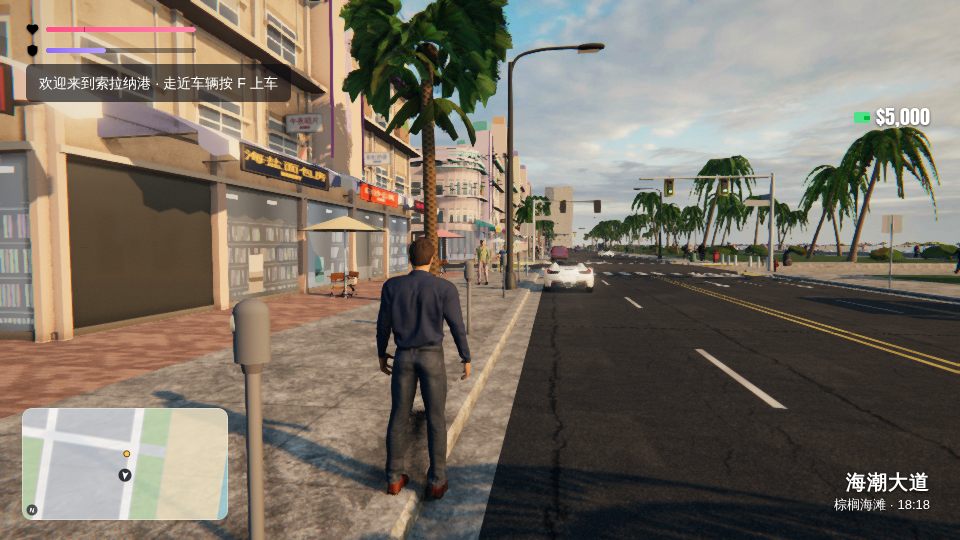
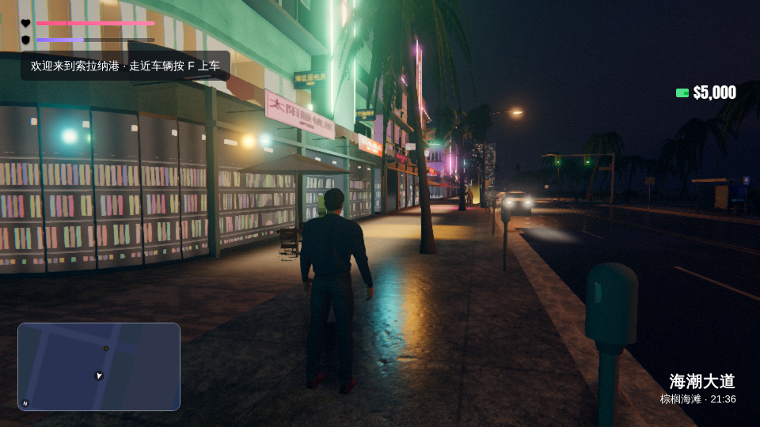

# 索拉纳港 Port Solana

An original, realistic open-world WebGL2 game (three.js + esbuild), aiming for the cinematic look and the gameplay depth of modern open-world crime games set in a sunny Florida-style coastal city. All names, characters and assets are original or openly licensed — no Rockstar / GTA names, characters, logos or assets.




## Status
Iterated continuously (about every 6 hours) by AI agents until 2026-12-19. See:
- `ITERATION_LOG.md` – what changed each round
- `ROADMAP.md` – prioritized backlog
- `GAMEPLAY_PLAN.md` – gameplay systems and phases (weapons, missions, police AI, economy, activities…)
- `MAP_DESIGN.md` – district layout and points of interest
- `SELFCHECK.md` – 10-dimension self-review scores (gameplay, handling, bugs, map, detail, textures, modeling, realism, fidelity, immersion)
- `GTA6_REFERENCE.md` – study notes on the reference look (reference images are not in this repo)

## Build & run
```bash
npm install
node build.cjs            # -> dist/index.html + dist/main.js (+ dist/assets)
npx http-server dist      # or: python3 -m http.server -d dist
node tools/single.cjs     # -> dist_single/index.html, one self-contained file
```
Needs a browser with WebGL2 and hardware acceleration. UI is Chinese.

Controls: WASD move/drive, mouse look, F enter/exit vehicle, Shift sprint, mouse to aim/shoot.

## Contributing (humans and agents)
Read `CONTRIBUTING.md` first — it defines the lock, branch and verification protocol so several agents can work in parallel without clobbering each other.

## License
Code: MIT. Assets: see `CREDITS.md` (CC0 / CC BY 4.0 / MIT / OFL).
